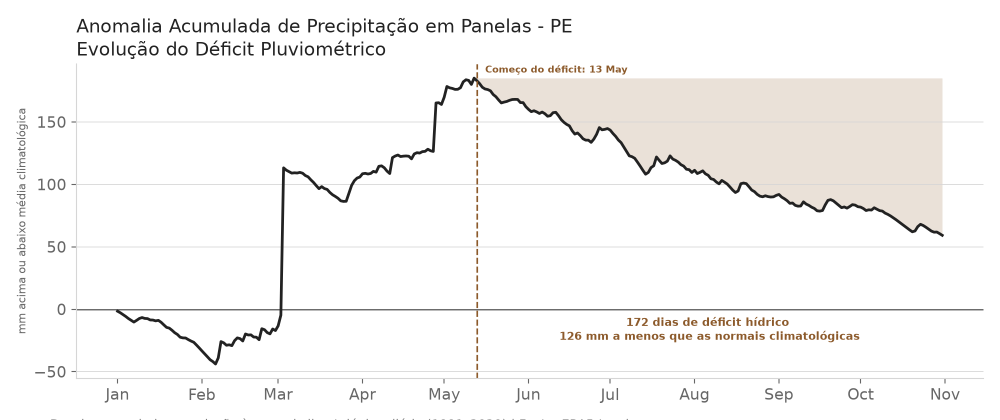
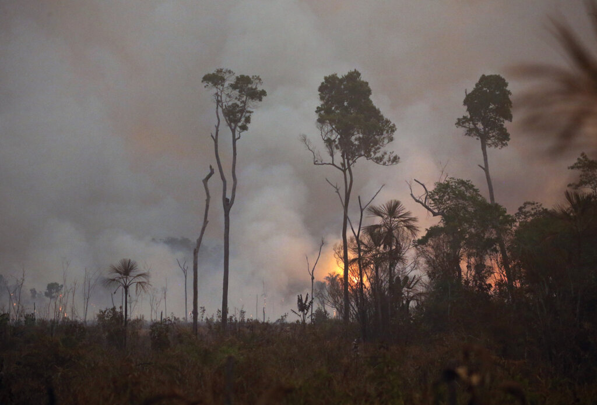

## Eventos Extremos no Brasil em 2026

Mensurar os impactos do El Nino não é uma tarefa trivial, pois a correlação entre os eventos extremos e a causalidade do fenômeno do El Nino e demanda de mais estudos com suas devidas nuances a serem avaliadas.  

Contudo, uma série de eventos extremos tem acontecido no segundo período de 2026 como já havia alertado a comunidade científica. Apesar de todo o alerta produzido sobre a intensidade do El Nino, nem todas as medidas cautelares foram tomadas em uníssono por todos os municípios para reduzir e mitigar possíveis danos.

Como parte do projeto final do programa Future Tech Leaders Brasil, decidimos ilustrar alguns do impactos de eventos extremos observados no Brasil em 2026 que podem estar correlacionados com o El Nino.

### El Nino

O El Nino é um fenômeno que demonstra um aquecimento anômalo das águas do pacífico. Ele é conhecido mundialmente e afeta o Brasil de diferentes formas. Como observado nas imagens, o El Nino impacta o Brasil de formas diferentes, para algumas regioes há um aumento na precipitação, causando cheias, alagamentos e tempestaes. Já para outras regiões, o El Nino afeta o regime hídrico de chuva, diminuindo a precipitação associada e causando secas severas e com regimes que facilitam a propagação de queimadas. 

## Anomalia da temperatura do Pacífico <!--{ as="img" mode="tour" style="object-fit: contain; background: #ffffff;" }-->

### <!--{ src="assets/oisst/oisst_anom_2026-07-01.png" }-->
#### Julho de 2026 e os primeiros sinais do El Nino
A faixa vermelha ao longo do Equador mostra águas até 3 °C mais quentes que o normal climatológica. Esse desvio já era esperado pelos cientistas que vinham alertado um El Niño sem precedentes. 

### <!--{ src="assets/oisst/oisst_anom_2026-09-01.png" }-->
#### Setembro de 2026 demonstra um fortalecimento do fenômeno.
Como demonstrado na imagem, retirada do monitoramento do NOAA, há um aumento na área superficial do oceano índico onde se é mensurado o fênomeno. Esse aumento é tanto em largura quanto em intensidade, com grande parte das águas já 3°C acima que as séries históricas.

### <!--{ src="assets/oisst/oisst_anom_2026-11-02.png" }-->
#### Novembro de 2026
Grande parte do oceano índico já está com as temperaturas de superfície bem acima dos 3 °C, em relação as séries históricas. Como iremos ver nos impactos a seguir, esse superaquecimento e fenômeno sem precedentes, já era conhecido por afetar a circulação atmosférica e vem causando uma série de estragos e prejuízos em todo o Brasil. 

*Dados: NOAA OISST v2.1, anomalia diária da temperatura da superfície do mar (0,25°), via NOAA CoastWatch ERDDAP.* <!--{ style="opacity: 0.7; font-size: 0.85rem;" }-->

## Impactos no Brasil <!--{ as="eox-map" class="overlay-br" mode="tour" }-->
Desde a segunda metade do ano de 2026, nos do FTL Brasil estamos mapeando alguns do eventos extremos que atingiram o Brasil. 

###  <!--{ projection="globe" layers='[{"type":"Tile","properties":{"id":"osm"},"source":{"type":"OSM"}}]' center=[-52,-14] zoom="4" animationOptions="{duration:500}" }-->

#### Como o El Niño impacta o Brasil em 2026.
Do sul ao norte do país, estamos contabilizando esses impactos e correlacionando com o El Nino.

### Tornados em Chapecó - Santa Catarina <!--{ projection="globe" layers='[{"type":"Tile","properties":{"id":"osm"},"source":{"type":"OSM"}},{"type":"Vector","properties":{"id":"chapeco"},"source":{"type":"Vector","features":[{"type":"Feature","geometry":{"type":"Point","coordinates":[-52.62,-27.10]},"properties":{"name":"Chapecó"}}]},"style":{"circle-radius":10,"circle-fill-color":"red","circle-stroke-color":"white","circle-stroke-width":2}}]' center=[-52.62,-27.10] zoom="7" animationOptions="{duration:2000}" }-->
Chapeco sofreu um fenome com tornados registrados no dia 05 de Novembro e atingindo munipios vizinhos. Com rajadas de vento na ordem dos 126km/h  mais de 300 pessoas tiveram que sair de suas casas e mais de 5000 casas foram danificadas ou afetadas. 

## Tornado dia 5 de Novembro <!--{ as="img" mode="tour" }-->
### <!--{ src="assets/fotos_reportagens/tornado-1-.avif" style="background: #fff0c4;" }-->
Em Chapecó, o centro de saúde foi fechado e há oputros com. problemas de energia. O aeroporto da cidade teve estruturas e vidraças destruídas com pousos e decolagens suspensos. 33 munícipios da região decretaram situação de emergência.

## Rastro do tornado em Chapecó <!--{ as="eox-map" class="overlay-br" mode="tour" }-->
O tornado deixou um rastro que pode ser visivel com as imagens de satelite. Olhe para a imagem próxima a saída final da pista do aeroporto, veja como o tornado destruiu a vegetação do morro e deixou um rastro.

### <!--{ projection="EPSG:3857" layers='[{"type":"Tile","properties":{"id":"osm"},"source":{"type":"OSM"}},{"type":"STAC","properties":{"id":"s2-pre"},"url":"https://earth-search.aws.element84.com/v1/collections/sentinel-2-l2a/items/S2B_22JCR_20260923_0_L2A"}]' center=[-52.68,-27.13] zoom="15" animationOptions="{duration:1500}" }-->
#### Imagens de Satélite antes do tornado 
Imagem Sentinel-2 no dia 23 de Setembro. 

### <!--{ projection="EPSG:3857" layers='[{"type":"Tile","properties":{"id":"osm"},"source":{"type":"OSM"}},{"type":"STAC","properties":{"id":"s2-post"},"url":"https://earth-search.aws.element84.com/v1/collections/sentinel-2-l2a/items/S2A_22JCR_20261109_0_L2A"}]' center=[-52.68,-27.13] zoom="15" animationOptions="{duration:1500}" }-->
#### Depois do tornado
Imagem do dia 9 de Novembro, 4 dias após o evento.

## Seca na Região Agreste de Pernambuco <!--{ as="eox-map" class="overlay-br" mode="tour" }-->

###  <!--{ projection="globe" layers='[{"type":"Tile","properties":{"id":"osm"},"source":{"type":"OSM"}}]' center=[-46.13,-8.66] zoom="6" animationOptions="{duration:1000}" }-->
#### Regime de Seca
A região agreste de Pernambuco vem sofrendo com a seca e diversos municípios já decretaram situação de emergência. Segundo a ANA, 25% do território de pernambuco já sofre com as secas 

### <!--{ projection="EPSG:3857" layers='[{"type":"Tile","properties":{"id":"osm"},"source":{"type":"OSM"}},{"type":"Vector","properties":{"id":"seca-nordeste"},"source":{"type":"Vector","url":"assets/seca/nordeste_seca_out26.geojson","format":"GeoJSON"},"style":{"fill-color":["match",["get","severidade"],"S0","rgba(255,255,0,0.7)","S1","rgba(252,211,127,0.7)","S2","rgba(255,170,0,0.7)","S3","rgba(230,0,0,0.7)","rgba(0,0,0,0)"],"stroke-color":"rgba(80,80,80,0.6)","stroke-width":0.5}}]' center=[-64,-9.7] zoom="5" animationOptions="{duration:1500}" }-->
#### Severidade da seca no Nordeste – Outubro de 2026

S0 – Seca fraca (amarelo) · S1 – Seca moderada (laranja claro) · S2 – Seca grave (laranja) · S3 – Seca extrema (vermelho)

*Dados: Monitor de Secas (ANA), outubro de 2026, recortado para a região Nordeste (IBGE/geobr).* <!--{ style="opacity: 0.7; font-size: 0.85rem;" }-->

### <!--{ projection="EPSG:3857" layers='[{"type":"Tile","properties":{"id":"osm"},"source":{"type":"OSM"}},{"type":"Tile","properties":{"id":"customId"},"source":{"type":"WMTSCapabilities","url":"https://tiles.maps.eox.at/wmts/1.0.0/WMTSCapabilities.xml","layer":"s2cloudless-2025"}}]' center=[-36.01,-8.66] zoom="11" animationOptions="{duration:2000}" }-->
#### Panelas – Agreste de Pernambuco
Vamos olhar de perto o município de Panelas, no Agreste pernambucano, e entender como a chuva se comportou em 2026.

## Entendendo a seca em Panelas - PE

### Entendendo o regime de seca
 <!--{ style="width: 100%; max-width: 720px; display: block; margin: 1rem auto;" }-->
Quando calculamos as precipitações baseada nas séries climatológicas, descobrimos que o ano de 2026 começou com precipitações acima das médias para o mês de Fevereiro, Março e Abril. Contudo, como as estações chuvosas nessa parte do território costumam ir de março até setembro, desde Maio está sendo registrado um déficit hídrico na região. 

### Acumulando a precipitação
 <!--{ style="width: 100%; max-width: 720px; display: block; margin: 1rem auto;" }-->
Ao olharmos o desvio acumulado de precipitação conseguimos visualizar de forma mais clara que o ínicio do ano começou com volumes de chuva acima da média climatológica, mas a partir do dia 13 de maio, é possível entender que o déficit hídrico se inicia. Calculamos que há 126 mm de chuva a menos comparado com as normais climatólogicas e a região de Panelas já se encontra há 172 dias em situação de déficit hídrico.

### Índice SPI
 <!--{ style="width: 100%; max-width: 720px; display: block; margin: 1rem auto;" }-->
O Índice Padronizado de Precipitação (SPI – Standardized Precipitation Index) permite avaliar, de forma estatística, o quanto a precipitação acumulada se desvia das condições climatológicas habituais. Valores negativos indicam precipitação abaixo da média histórica, enquanto valores positivos representam condições mais húmidas que o normal. No gráfico, o SPI-6 representa o comportamento da precipitação acumulada ao longo de seis meses, permitindo identificar episódios de seca meteorológica e avaliar a sua intensidade e persistência.

As áreas sombreadas em alaranjado correspondem aos períodos de ocorrência do fenómeno El Niño. A sua representação permite observar a possível relação temporal entre esse fenómeno climático e os episódios de seca registados em Panelas (PE). Nota-se que alguns períodos de El Niño coincidem com episódios de SPI negativo, sugerindo uma possível influência na redução das chuvas na região. Contudo, essa coincidência temporal não estabelece, por si só, uma relação direta de causalidade, uma vez que o regime pluviométrico do Nordeste brasileiro também é condicionado por outros factores oceânicos e atmosféricos.

## El Niño na Paraíba em 2026 <!--{ as="eox-map" class="overlay-br" mode="tour" }-->

### <!--{ projection="EPSG:3857" layers='[{"type":"Tile","properties":{"id":"osm"},"source":{"type":"OSM"}},{"type":"Vector","properties":{"id":"paraiba"},"source":{"type":"Vector","url":"assets/paraiba/limite_paraiba_ibge.geojson","format":"GeoJSON"},"style":{"fill-color":"rgba(230,130,40,0.12)","stroke-color":"#b45309","stroke-width":3}}]' zoomExtent=[-4315323,-927111,-3874218,-672331] animationOptions="{duration:1000,padding:[50,24,180,24]}" }-->
#### Um fenômeno no Pacífico, efeitos na Paraíba

O El Niño envolve o aquecimento anormal das águas do Pacífico Equatorial e mudanças na circulação atmosférica. Essa combinação pode favorecer calor e redução de chuvas em áreas do Nordeste. A resposta varia entre regiões e épocas do ano, e também depende do Atlântico Tropical. Por isso, precisamos olhar para a Paraíba em diferentes escalas. [Fonte: INMET, 13/11/2026](https://portal.inmet.gov.br/noticias/el-ni%C3%B1o-deve-atingir-sua-intensidade-m%C3%A1xima-no-trimestre-novembro-dezembro-janeiro-e-deve-persistir-at%C3%A9-o-outono-de-2027).

*O contorno localiza a Paraíba; a cor não indica intensidade de seca. Limite estadual: [IBGE, malha simplificada](https://servicodados.ibge.gov.br/api/v3/malhas/estados/25?formato=application/vnd.geo%2Bjson&qualidade=minima).* <!--{ style="font-size: 0.9rem;" }-->

### <!--{ projection="EPSG:3857" layers='[{"type":"Tile","properties":{"id":"osm"},"source":{"type":"OSM"}},{"type":"Vector","properties":{"id":"paraiba"},"source":{"type":"Vector","url":"assets/paraiba/limite_paraiba_ibge.geojson","format":"GeoJSON"},"style":{"fill-color":"rgba(230,130,40,0.12)","stroke-color":"#b45309","stroke-width":3}}]' center=[-37.25,-7.15] zoom="9" animationOptions="{duration:1500}" }-->
#### Sertão e Cariri: calor e pressão sobre a água

Na reportagem do g1 de 26 de julho, a meteorologista Morgana Almeida, do INSA, apontava o Sertão e o Cariri como áreas especialmente expostas ao aumento do calor e à baixa umidade. Como o segundo semestre já inclui meses de estiagem, a preocupação era a intensificação dessas condições.

Temperaturas mais altas podem aumentar a evaporação nos reservatórios e a demanda por água e energia. Isso representa um risco para o abastecimento, mas não comprova, por si só, falta de água ou perdas já ocorridas em cada município. [Fonte: g1 PB, 26/07/2026](https://g1.globo.com/pb/paraiba/noticia/2026/07/26/el-nino-2026-entenda-como-o-fenomeno-climatico-deve-afetar-a-paraiba.ghtml).

### <!--{ projection="EPSG:3857" layers='[{"type":"Tile","properties":{"id":"osm"},"source":{"type":"OSM"}},{"type":"Vector","properties":{"id":"paraiba"},"source":{"type":"Vector","url":"assets/paraiba/limite_paraiba_ibge.geojson","format":"GeoJSON"},"style":{"fill-color":"rgba(230,130,40,0.12)","stroke-color":"#b45309","stroke-width":3}}]' center=[-35.5,-7.05] zoom="9" animationOptions="{duration:1500}" }-->
#### Litoral, Brejo e Agreste: atenção ao calendário das chuvas

No leste do estado, é importante considerar as chuvas de outono e inverno. O boletim divulgado pelo INSA em 8 de julho previa precipitação abaixo da média no leste da Paraíba entre julho e setembro de 2026, além de temperaturas acima da média no Nordeste. Essa era uma previsão para o trimestre, que deve ser comparada com os registros observados.

Menos chuva no acumulado também não elimina temporais localizados: sistemas como os Distúrbios Ondulatórios de Leste podem provocar episódios intensos. [Fonte: INSA, 08/07/2026](https://www.gov.br/insa/pt-br/assuntos/noticias/ultimas-noticias/el-nino-deve-reduzir-chuvas-e-elevar-temperaturas-no-nordeste-entre-julho-e-setembro-aponta-boletim-climatico).

## Paraíba: o que os dados de 2026 mostram

### Setembro mais seco não significa um ano inteiro de déficit

Os registros da AESA mostram chuva abaixo da média em todas as regiões pluviométricas da Paraíba em **setembro de 2026**. A tabela apresenta médias regionais, não valores de uma única cidade.

| Região | Chuva (mm) | Desvio (mm) |
|---|---:|---:|
| Litoral | 46,9 | -20,4 |
| Brejo | 17,7 | -24,6 |
| Agreste | 15,0 | -13,3 |
| Curimataú | 2,6 | -3,1 |
| Cariri | 1,3 | -4,8 |
| Sertão | 0,1 | -2,1 |
| Alto Sertão | 1,8 | -2,6 |

*Desvio = chuva observada menos a referência climatológica. Fonte: [AESA/PBCLIMA, páginas 5–7](https://www.aesa.pb.gov.br/assets/uploads/2026/11/Boletim-Climatico-Mensal_PBCLIMA_AESA_OUTUBRO_2026.pdf). Apesar do nome “OUTUBRO” no arquivo, o texto e as figuras analisam setembro de 2026.*

Já no acumulado de **janeiro a setembro**, o Agreste estava 39,1% acima da média e o Litoral, 23,5% acima; o Cariri registrava déficit de 6,0%. Assim, um mês com pouca chuva não permite concluir que todo o estado passou o ano em seca. Esses dados descrevem a precipitação e não isolam a contribuição do El Niño.

### Água, produção rural e prevenção

Para quem depende da chuva e dos açudes, uma estiagem prolongada pode dificultar o cultivo, a manutenção das pastagens e a criação de animais. A publicação do [Geografia da Paraíba, de 15/06/2026](https://www.facebook.com/GeografiaPB/posts/voc%C3%AA-sabia-que-a-chegada-de-um-poss%C3%ADvel-super-el-ni%C3%B1o-preocupa-pesquisadores-e-g/1020553050369378/) chama atenção para essa vulnerabilidade. São riscos a acompanhar, e não um levantamento de prejuízos agrícolas de 2026.

O planejamento estadual também já considera reservatórios, estiagem, ondas de calor e incêndios. Em outubro, o Corpo de Bombeiros informou sua participação na preparação de uma resposta conjunta entre órgãos públicos, com base em perspectivas da AESA de condições mais quentes, secas e de chuvas irregulares. [Fonte: CBMPB, 05/10/2026](https://bombeiros.pb.gov.br/2026/10/05/cbmpb-participa-de-planejamento-estadual-para-resposta-a-possiveis-impactos-do-el-nino/).

### O que acompanhar na passagem para 2027

Na atualização de **13 de novembro de 2026**, o INMET apontava o pico do fenômeno para novembro de 2026 a janeiro de 2027, com enfraquecimento posterior. O possível retorno à neutralidade no outono de 2027 não garante normalização imediata das chuvas. Para a Paraíba, isso reforça a necessidade de acompanhar a próxima estação chuvosa e a situação dos reservatórios. [Fonte: INMET, 13/11/2026](https://portal.inmet.gov.br/noticias/el-ni%C3%B1o-deve-atingir-sua-intensidade-m%C3%A1xima-no-trimestre-novembro-dezembro-janeiro-e-deve-persistir-at%C3%A9-o-outono-de-2027).

Esta contribuição reúne **observações de chuva e riscos previstos**, com fontes consultadas em **24/11/2026**. Para atribuir um evento específico ao El Niño, seria necessário um estudo que avaliasse sua influência junto a outros fatores climáticos. O monitoramento pode ser acompanhado nos [boletins da AESA](https://www.aesa.pb.gov.br/boletins/).

## A região amazônica no mapa <!--{ as="eox-map" class="overlay-br" mode="tour" }-->

### <!--{ projection="EPSG:3857" layers='[{"type":"Tile","properties":{"id":"osm"},"source":{"type":"OSM"}},{"type":"Vector","properties":{"id":"bioma-amazonia"},"source":{"type":"Vector","url":"assets/amazonia/limite_bioma_amazonia_ibge.geojson","format":"GeoJSON"},"style":{"fill-color":"rgba(34,139,69,0.16)","stroke-color":"#15803d","stroke-width":2}},{"type":"Vector","properties":{"id":"localidades-amazonia"},"source":{"type":"Vector","features":[{"type":"Feature","geometry":{"type":"Point","coordinates":[-64.8,-7.26]},"properties":{"nome":"Lábrea (AM)"}},{"type":"Feature","geometry":{"type":"Point","coordinates":[-54.71,-2.44]},"properties":{"nome":"Santarém (PA)"}}]},"style":{"circle-radius":7,"circle-fill-color":"#c2410c","circle-stroke-color":"white","circle-stroke-width":2,"text-value":["get","nome"],"text-font":"600 13px sans-serif","text-offset-y":-18,"text-fill-color":"#172b36","text-stroke-color":"white","text-stroke-width":3}}]' zoomExtent=[-8235750,-1881515,-4831188,587438] animationOptions="{duration:1000,padding:[50,24,180,24]}" }-->
#### O bioma Amazônia no Brasil

O contorno verde mostra a extensão do bioma Amazônia em território brasileiro. Os marcadores laranja localizam as sedes de Lábrea (AM) e Santarém (PA), usadas como referências geográficas no conteúdo sobre queimadas. Role a página para conhecer essas áreas mais de perto.

*Limite do bioma: [IBGE (2019), disponibilizado pelo Ibama](https://pamgia.ibama.gov.br/server/rest/services/01_Publicacoes_Bases/biomas_ibge_250k_2019/FeatureServer/2), simplificado para visualização. Base cartográfica: OpenStreetMap.* <!--{ style="font-size: 0.85rem;" }-->

### <!--{ projection="EPSG:3857" layers='[{"type":"Tile","properties":{"id":"osm"},"source":{"type":"OSM"}},{"type":"Vector","properties":{"id":"bioma-amazonia"},"source":{"type":"Vector","url":"assets/amazonia/limite_bioma_amazonia_ibge.geojson","format":"GeoJSON"},"style":{"fill-color":"rgba(34,139,69,0.16)","stroke-color":"#15803d","stroke-width":2}},{"type":"Vector","properties":{"id":"localidades-amazonia"},"source":{"type":"Vector","features":[{"type":"Feature","geometry":{"type":"Point","coordinates":[-64.8,-7.26]},"properties":{"nome":"Lábrea (AM)"}},{"type":"Feature","geometry":{"type":"Point","coordinates":[-54.71,-2.44]},"properties":{"nome":"Santarém (PA)"}}]},"style":{"circle-radius":7,"circle-fill-color":"#c2410c","circle-stroke-color":"white","circle-stroke-width":2,"text-value":["get","nome"],"text-font":"600 13px sans-serif","text-offset-y":-18,"text-fill-color":"#172b36","text-stroke-color":"white","text-stroke-width":3}}]' center=[-64.8,-7.26] zoom="8" animationOptions="{duration:1500}" }-->
#### Lábrea, no sul do Amazonas

O mapa aproxima Lábrea, município da fotografia que acompanha a seção seguinte. O ponto destaca a sede municipal para ajudar a localizar essa parte da Amazônia.

### <!--{ projection="EPSG:3857" layers='[{"type":"Tile","properties":{"id":"osm"},"source":{"type":"OSM"}},{"type":"Vector","properties":{"id":"bioma-amazonia"},"source":{"type":"Vector","url":"assets/amazonia/limite_bioma_amazonia_ibge.geojson","format":"GeoJSON"},"style":{"fill-color":"rgba(34,139,69,0.16)","stroke-color":"#15803d","stroke-width":2}},{"type":"Vector","properties":{"id":"localidades-amazonia"},"source":{"type":"Vector","features":[{"type":"Feature","geometry":{"type":"Point","coordinates":[-64.8,-7.26]},"properties":{"nome":"Lábrea (AM)"}},{"type":"Feature","geometry":{"type":"Point","coordinates":[-54.71,-2.44]},"properties":{"nome":"Santarém (PA)"}}]},"style":{"circle-radius":7,"circle-fill-color":"#c2410c","circle-stroke-color":"white","circle-stroke-width":2,"text-value":["get","nome"],"text-font":"600 13px sans-serif","text-offset-y":-18,"text-fill-color":"#172b36","text-stroke-color":"white","text-stroke-width":3}}]' center=[-54.71,-2.44] zoom="8" animationOptions="{duration:1500}" }-->
#### Santarém e o oeste do Pará

A aproximação mostra Santarém, no encontro dos rios Tapajós e Amazonas. Essa é uma das áreas citadas na reportagem sobre o avanço das queimadas e da fumaça em comunidades e escolas do oeste paraense. [Fonte: InfoAmazonia, 17/11/2026](https://infoamazonia.org/2026/11/17/queimadas-chegam-mais-tarde-na-amazonia-mas-novembro-ja-supera-2023-com-influencia-do-el-nino/).

## Queimadas na Região Amazônica

Na Amazônia, o El Niño pode reduzir as chuvas e intensificar a seca, deixando a vegetação mais vulnerável ao fogo. As queimadas têm origem predominantemente humana, como no uso do fogo para limpar áreas; o clima mais seco favorece a propagação das chamas.

 <!--{ loading="lazy" decoding="async" style="width: 100%; max-width: 1000px; height: auto; display: block; margin: 1.5rem auto 0.5rem;" }-->

*Queimada às margens da BR-230, em Lábrea (AM), em 4 de setembro de 2024. Foto: Edmar Barros / [Amazônia Latitude](https://www.amazonialatitude.com/2025/01/29/el-nino-impacto-seca-aguas-subterraneas-amazonia-incendio-estudo/).* <!--{ style="font-size: 0.85rem;" }-->

### A seca também acontece debaixo da terra

Um estudo com dados de **2004 a 2016** relacionou as queimadas à redução da umidade do solo, da zona das raízes e das reservas subterrâneas. Os pesquisadores usaram dados da missão **GRACE** e observaram que essas reservas podem demorar mais a se recuperar após secas extremas. Monitorar apenas a chuva, portanto, não basta para entender a vulnerabilidade da floresta. [Fonte: Agência FAPESP, republicada pela Amazônia Latitude em 29/01/2025](https://www.amazonialatitude.com/2025/01/29/el-nino-impacto-seca-aguas-subterraneas-amazonia-incendio-estudo/).

Esses resultados históricos ajudam a explicar o risco, mas não medem a contribuição do El Niño para cada incêndio de 2026.

### O avanço do fogo em 2026

Em **17 de novembro de 2026**, a InfoAmazonia relatou que chuvas prolongadas no primeiro semestre atrasaram a temporada de fogo, mas as queimadas ganharam força em novembro. No **Pará**, foram registrados **4.635 focos de calor nos primeiros dez dias de novembro**, contra **2.903 no mesmo período de 2023**, segundo a análise com dados do INPE. A reportagem também descreve incêndios próximos a comunidades e escolas no oeste do estado. [Fonte: InfoAmazonia, 17/11/2026](https://infoamazonia.org/2026/11/17/queimadas-chegam-mais-tarde-na-amazonia-mas-novembro-ja-supera-2023-com-influencia-do-el-nino/).

### Fumaça e impactos na saúde

A fumaça afeta tanto quem vive perto das chamas quanto populações distantes, pois os ventos transportam os poluentes. Ela contém partículas finas que podem agravar doenças respiratórias, como asma e bronquite, e aumentar o risco de problemas cardiovasculares. Crianças, idosos, gestantes e pessoas com doenças preexistentes estão entre os grupos mais vulneráveis.

Nos dias de fumaça intensa, é importante reduzir a exposição, evitar atividades físicas ao ar livre e acompanhar as orientações dos serviços de saúde. [Fonte: Ministério da Saúde — Queimadas](https://www.gov.br/saude/pt-br/assuntos/saude-de-a-a-z/q/queimadas/queimadas).

### Onde acompanhar e quem atua?

O [Programa Queimadas do INPE](https://data.inpe.br/queimadas/portal/) disponibiliza mapas, séries históricas e dados para consulta. Para localizar os registros, selecione o bioma Amazônia, o estado, o município e o intervalo de datas no painel de focos. Ao comparar anos, mantenha o mesmo período e a mesma série de satélite.

**Um foco de calor não equivale necessariamente a um incêndio individual nem informa, sozinho, a área queimada.** Um incêndio pode gerar várias detecções, enquanto fogo pequeno ou encoberto pode não ser identificado. Os dados de focos devem ser analisados junto aos produtos de área queimada. [Entenda o monitoramento do INPE](https://data.inpe.br/queimadas/portal/faq/).

O INPE produz informações para orientar a resposta, mas não fiscaliza nem combate o fogo. A prevenção e o combate dependem da atuação de órgãos ambientais, brigadistas e equipes locais. Acompanhar os alertas e evitar o uso irregular do fogo são medidas importantes para reduzir o risco durante a estiagem.

## Agradecimentos

Este trabalho é resultado do projeto final apresentado no programa Future Tech Leaders Brasil. Feito em parceria pelos estudantes:
- Luiz Henrique Araújo de Brito 
- Mariana Lebrão Murauskas
- Lucas Sousa Costa
- Laissa P.
- Gabrielle Vasconcelos de Mendonça Penha
- Laíne Reis de Moura
- Flávio Arthur Campos Figueira
- Douglas Rodrigues da Silva
- Danielle Mota Torres Nogueira
- Camila Yukari Kobayashi
- Ayronn Medina Zago Assen
- Alice Gomes Pereira
