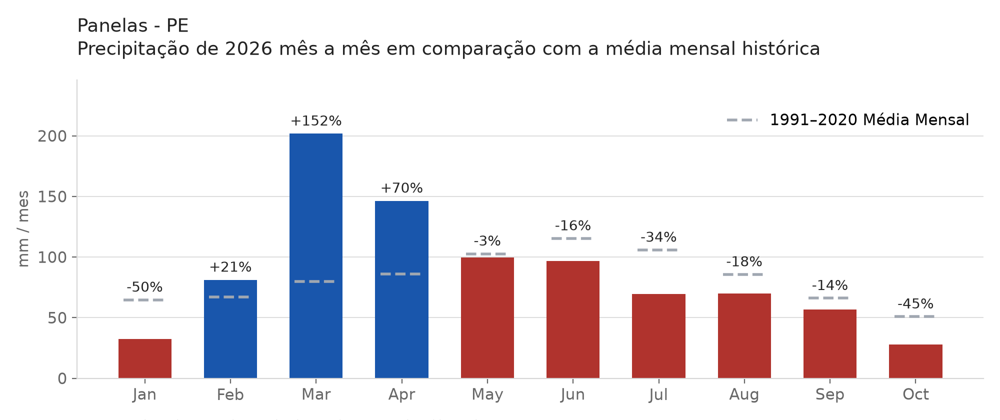
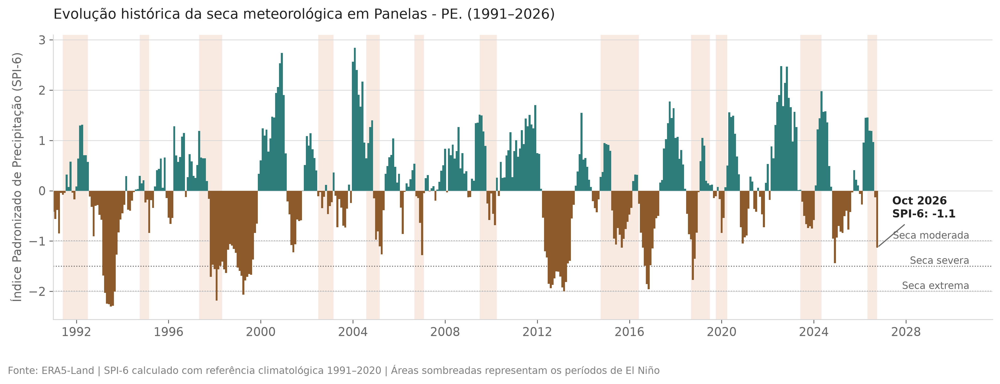

# Hero Section <!--{ as="image" mode="hero" src="assets/fotos_reportagens/capa_provisoria.png" }-->
#### Eventos Extremos no Brasil em 2026 <!--{ style="font-size:5rem;opacity:0.7;margin-top:1rem;" }-->

## Eventos Extremos no Brasil em 2026

Mensurar os impactos do El Nino não é uma tarefa trivial, pois a correlação entre os eventos extremos e a causalidade do fenômeno do El Nino e demanda de mais estudos com suas devidas nuances a serem avaliadas.  

Contudo, uma série de eventos extremos tem acontecido no segundo período de 2026 como já havia alertado a comunidade científica. Apesar de todo o alerta produzido sobre a intensidade do El Nino, nem todas as medidas cautelares foram tomadas em uníssono por todos os municípios para reduzir e mitigar possíveis danos.

Como parte do projeto final do programa Future Tech Leaders Brasil, decidimos ilustrar alguns do impactos de eventos extremos observados no Brasil em 2026 que podem estar correlacionados com o El Nino.

### El Nino

O El Nino é um fenômeno que demonstra um aquecimento anômalo das águas do pacífico. Ele é conhecido mundialmente e afeta o Brasil de diferentes formas. Como observado nas imagens, o El Nino impacta o Brasil de formas diferentes, para algumas regioes há um aumento na precipitação, causando cheias, alagamentos e tempestaes. Já para outras regiões, o El Nino afeta o regime hídrico de chuva, diminuindo a precipitação associada e causando secas severas e com regimes que facilitam a propagação de queimadas. 

## Anomalia da temperatura do Pacífico <!--{ as="img" mode="tour" style="object-fit: contain; background: #ffffff;" }-->

### <!--{ src="assets/oisst/oisst_anom_2026-07-01.png" }-->
#### Julho de 2026 e os primeiros sinais do El Nino
A faixa vermelha ao longo do Equador mostra águas até 3 °C mais quentes que o normal climatológica. Esse desvio já era esperado pelos cientistas que vinham alertado um El Niño sem precedentes. 

### <!--{ src="assets/oisst/oisst_anom_2026-09-01.png" }-->
#### Setembro de 2026 demonstra um fortalecimento do fenômeno.
Como demonstrado na imagem, retirada do monitoramento do NOAA, há um aumento na área superficial do oceano índico onde se é mensurado o fênomeno. Esse aumento é tanto em largura quanto em intensidade, com grande parte das águas já 3°C acima que as séries históricas.

### <!--{ src="assets/oisst/oisst_anom_2026-11-02.png" }-->
#### Novembro de 2026
Grande parte do oceano índico já está com as temperaturas de superfície bem acima dos 3 °C, em relação as séries históricas. Como iremos ver nos impactos a seguir, esse superaquecimento e fenômeno sem precedentes, já era conhecido por afetar a circulação atmosférica e vem causando uma série de estragos e prejuízos em todo o Brasil. 

*Dados: NOAA OISST v2.1, anomalia diária da temperatura da superfície do mar (0,25°), via NOAA CoastWatch ERDDAP.* <!--{ style="opacity: 0.7; font-size: 0.85rem;" }-->

## Impactos no Brasil <!--{ as="eox-map" class="overlay-br" mode="tour" }-->
Desde a segunda metade do ano de 2026, nos do FTL Brasil estamos mapeando alguns do eventos extremos que atingiram o Brasil. 

###  <!--{ projection="globe" layers='[{"type":"Tile","properties":{"id":"osm"},"source":{"type":"OSM"}}]' center=[-52,-14] zoom="4" animationOptions="{duration:500}" }-->

#### Como o El Niño impacta o Brasil em 2026.
Do sul ao norte do país, estamos contabilizando esses impactos e correlacionando com o El Nino.

### Tornados em Chapecó - Santa Catarina <!--{ projection="globe" layers='[{"type":"Tile","properties":{"id":"osm"},"source":{"type":"OSM"}},{"type":"Vector","properties":{"id":"chapeco"},"source":{"type":"Vector","features":[{"type":"Feature","geometry":{"type":"Point","coordinates":[-52.62,-27.10]},"properties":{"name":"Chapecó"}}]},"style":{"circle-radius":10,"circle-fill-color":"red","circle-stroke-color":"white","circle-stroke-width":2}}]' center=[-52.62,-27.10] zoom="7" animationOptions="{duration:2000}" }-->
Chapeco sofreu um fenome com tornados registrados no dia 05 de Novembro e atingindo munipios vizinhos. Com rajadas de vento na ordem dos 126km/h  mais de 300 pessoas tiveram que sair de suas casas e mais de 5000 casas foram danificadas ou afetadas. 

## Tornado dia 5 de Novembro <!--{ as="img" mode="tour" }-->
### <!--{ src="assets/fotos_reportagens/tornado-1-.avif" style="background: #fff0c4;" }-->
Em Chapecó, o centro de saúde foi fechado e há oputros com. problemas de energia. O aeroporto da cidade teve estruturas e vidraças destruídas com pousos e decolagens suspensos. 33 munícipios da região decretaram situação de emergência.

## Rastro do tornado em Chapecó <!--{ as="eox-map" class="overlay-br" mode="tour" }-->
O tornado deixou um rastro que pode ser visivel com as imagens de satelite. Olhe para a imagem próxima a saída final da pista do aeroporto, veja como o tornado destruiu a vegetação do morro e deixou um rastro.

### <!--{ projection="EPSG:3857" layers='[{"type":"Tile","properties":{"id":"osm"},"source":{"type":"OSM"}},{"type":"STAC","properties":{"id":"s2-pre"},"url":"https://earth-search.aws.element84.com/v1/collections/sentinel-2-l2a/items/S2B_22JCR_20260923_0_L2A"}]' center=[-52.68,-27.13] zoom="15" animationOptions="{duration:1500}" }-->
#### Imagens de Satélite antes do tornado 
Imagem Sentinel-2 no dia 23 de Setembro. 

### <!--{ projection="EPSG:3857" layers='[{"type":"Tile","properties":{"id":"osm"},"source":{"type":"OSM"}},{"type":"STAC","properties":{"id":"s2-post"},"url":"https://earth-search.aws.element84.com/v1/collections/sentinel-2-l2a/items/S2A_22JCR_20261109_0_L2A"}]' center=[-52.68,-27.13] zoom="15" animationOptions="{duration:1500}" }-->
#### Depois do tornado
Imagem do dia 9 de Novembro, 4 dias após o evento.

## Seca na Região Agreste de Pernambuco <!--{ as="eox-map" class="overlay-br" mode="tour" }-->

###  <!--{ projection="globe" layers='[{"type":"Tile","properties":{"id":"osm"},"source":{"type":"OSM"}}]' center=[-46.13,-8.66] zoom="6" animationOptions="{duration:1000}" }-->
#### Regime de Seca
A região agreste de Pernambuco vem sofrendo com a seca e diversos municípios já decretaram situação de emergência. Segundo a ANA, 25% do território de pernambuco já sofre com as secas 

### <!--{ projection="EPSG:3857" layers='[{"type":"Tile","properties":{"id":"osm"},"source":{"type":"OSM"}},{"type":"Vector","properties":{"id":"seca-nordeste"},"source":{"type":"Vector","url":"assets/seca/nordeste_seca_out26.geojson","format":"GeoJSON"},"style":{"fill-color":["match",["get","severidade"],"S0","rgba(255,255,0,0.7)","S1","rgba(252,211,127,0.7)","S2","rgba(255,170,0,0.7)","S3","rgba(230,0,0,0.7)","rgba(0,0,0,0)"],"stroke-color":"rgba(80,80,80,0.6)","stroke-width":0.5}}]' center=[-64,-9.7] zoom="5" animationOptions="{duration:1500}" }-->
#### Severidade da seca no Nordeste – Outubro de 2026

S0 – Seca fraca (amarelo) · S1 – Seca moderada (laranja claro) · S2 – Seca grave (laranja) · S3 – Seca extrema (vermelho)

*Dados: Monitor de Secas (ANA), outubro de 2026, recortado para a região Nordeste (IBGE/geobr).* <!--{ style="opacity: 0.7; font-size: 0.85rem;" }-->

### <!--{ projection="EPSG:3857" layers='[{"type":"Tile","properties":{"id":"osm"},"source":{"type":"OSM"}},{"type":"Tile","properties":{"id":"customId"},"source":{"type":"WMTSCapabilities","url":"https://tiles.maps.eox.at/wmts/1.0.0/WMTSCapabilities.xml","layer":"s2cloudless-2025"}}]' center=[-36.01,-8.66] zoom="11" animationOptions="{duration:2000}" }-->
#### Panelas – Agreste de Pernambuco
Vamos olhar de perto o município de Panelas, no Agreste pernambucano, e entender como a chuva se comportou em 2026.

## Entendendo a seca em Panelas - PE

### Entendendo o regime de seca
 <!--{ style="width: 100%; max-width: 720px; display: block; margin: 1rem auto;" }-->
Quando calculamos as precipitações baseada nas séries climatológicas, descobrimos que o ano de 2026 começou com precipitações acima das médias para o mês de Fevereiro, Março e Abril. Contudo, como as estações chuvosas nessa parte do território costumam ir de março até setembro, desde Maio está sendo registrado um déficit hídrico na região. 

### Acumulando a precipitação
 <!--{ style="width: 100%; max-width: 720px; display: block; margin: 1rem auto;" }-->
Ao olharmos o desvio acumulado de precipitação conseguimos visualizar de forma mais clara que o ínicio do ano começou com volumes de chuva acima da média climatológica, mas a partir do dia 13 de maio, é possível entender que o déficit hídrico se inicia. Calculamos que há 126 mm de chuva a menos comparado com as normais climatólogicas e a região de Panelas já se encontra há 172 dias em situação de déficit hídrico.

### Índice SPI
 <!--{ style="width: 100%; max-width: 720px; display: block; margin: 1rem auto;" }-->
O Índice Padronizado de Precipitação (SPI – Standardized Precipitation Index) permite avaliar, de forma estatística, o quanto a precipitação acumulada se desvia das condições climatológicas habituais. Valores negativos indicam precipitação abaixo da média histórica, enquanto valores positivos representam condições mais húmidas que o normal. No gráfico, o SPI-6 representa o comportamento da precipitação acumulada ao longo de seis meses, permitindo identificar episódios de seca meteorológica e avaliar a sua intensidade e persistência.

As áreas sombreadas em alaranjado correspondem aos períodos de ocorrência do fenómeno El Niño. A sua representação permite observar a possível relação temporal entre esse fenómeno climático e os episódios de seca registados em Panelas (PB). Nota-se que alguns períodos de El Niño coincidem com episódios de SPI negativo, sugerindo uma possível influência na redução das chuvas na região. Contudo, essa coincidência temporal não estabelece, por si só, uma relação direta de causalidade, uma vez que o regime pluviométrico do Nordeste brasileiro também é condicionado por outros factores oceânicos e atmosféricos.

## Queimadas na R1egião Amazônica
Continuar daqui as queimadas na amazônia.

### Onde? Como verificar? Quem? 

## Agradecimentos

Este trabalho é resultado do projeto final apresentado no programa Future Tech Leaders Brasil. Feito em parceria pelos estudantes:
- Luiz Henrique Araújo de Brito 
- Mariana Lebrão Murauskas
- Lucas Sousa Costa
- Laissa P.
- Gabrielle Vasconcelos de Mendonça Penha
- Laíne Reis de Moura
- Flávio Arthur Campos Figueira
- Douglas Rodrigues da Silva
- Danielle Mota Torres Nogueira
- Camila Yukari Kobayashi
- Ayronn Medina Zago Assen
- Alice Gomes Pereira